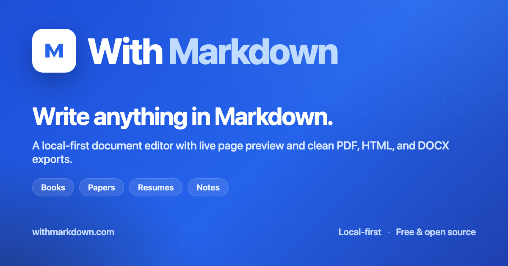

<div align="center">


# With Markdown

Write anything in Markdown — books, papers, resumes, reports, notes.

[][app]
[][coffee]

[][app]

</div>

## About

With Markdown is a local-first document editor that works like a word processor but is written in Markdown. It combines a code editor with a paginated, print-accurate live preview, practical page and typography controls, and self-contained export options.

Use it for a novel, an academic paper, a resume, a report, or your notes — the same editor and the same clean output, without locking your words inside a proprietary file format.

Your documents, images, and settings stay in your browser. No account is required, and your content is not uploaded to an application server.

See the [Changelog](CHANGELOG.md) for the complete project history and latest changes.

## Notice

Highly recommend using Chromium-based browsers, e.g., [Chrome][chrome] or [Microsoft Edge][edge].

## Features

- Write any document in Markdown and preview real pages as you type
- Presentation slides with [Marp](https://marp.app): write a deck in Markdown, present it full screen, and export to PDF or a standalone HTML deck
- Works offline ([PWA][pwa])
- Export to PDF, Markdown, self-contained HTML, and DOCX
- Export to A4 and US Letter paper sizes
- Customize page margins, theme colors, line heights, fonts, etc.
- Add icons easily with Markdown syntax (`::icon::`) via [Iconify](https://github.com/iconify/iconify) (search icons on [Icônes](https://icones.js.org/))
- Fix legacy Iconify markup from older documents by converting it to Markdown icon syntax
- TeX support ([KaTeX](https://github.com/KaTeX/KaTeX))
- Cross-referencing (useful for academic papers and reports)
- Case correction (e.g., `Github` → `GitHub`)
- Add line breaks (`\\[10px]`) or start a new page (`\newpage`) like in LaTeX
- Automatic page breaking
- Custom CSS support
- Manage, rename, duplicate, import, back up, and delete multiple documents
- Automatically save editor changes when adding a new line, with Ctrl/Cmd+S support
- Responsive editing layout for desktop, tablet, and mobile
- Optional Monaco editor minimap
- Light document previews in every color theme
- Light, dark, and system appearance modes
- English, Indonesian, Spanish, and Chinese interface languages
- Local storage usage estimates, refresh controls, and a protected factory-reset action
- Data is saved locally in your browser using IndexedDB browser feature (see [`localForage` repo](https://localforage.github.io/localForage/) for details)
- **Image Gallery** — upload images and reference them in your document using Markdown or HTML (see below)

## Slides

With Markdown can also turn Markdown into presentation slides using [Marp](https://marp.app/). Open **My Slides**, write your deck with `---` between slides, pick one of the bundled themes (Default, Gaia, or Uncover), then present it full screen or export it as a PDF or a standalone HTML deck.


## Icon Support

Add icons to your document with Markdown syntax, e.g. `::mdi:home::`. Search icons on [Icônes](https://icones.js.org/) and use the Iconify icon names.

You can also set the size and color of an icon:

```markdown
::mdi:home =24 /red::
```

The **Fix Icons** toolbar tool automatically converts legacy markup — both old `<span class="iconify" data-icon="...">` markup and `<iconify-icon icon="...">` tags — into this Markdown syntax.

## Image Support

The Image Gallery screen lets you upload images and use them directly in your document.

Once uploaded, each image gets a stable URL in the format `./images/<id>` served by a [Service Worker][sw] — no external hosting needed. You can copy the URL from the gallery and paste it into your Markdown:

```markdown

```

Or as an HTML tag:

```html

```

When exporting to **HTML** or **DOCX**, image references are automatically replaced with inline base64 data URLs so the exported file is fully self-contained.

**Privacy:** Images are stored entirely inside your browser's IndexedDB — the same storage used for your documents. They are never uploaded to any server and never leave your computer.

## Self-Hosting

1. Clone the repository:

    ```bash
    git clone https://github.com/junian/create-with-markdown.git
    cd create-with-markdown
    ```

2. (Optional) Set up your environment variables. Copy the example file and fill in the values you need:

    ```bash
    cp .env.example .env
    ```

    See the [Environment Variables](#environment-variables) section for details on each variable.

3. Run the build script:

    ```bash
    ./build.sh
    ```

4. Deploy the contents of the `.output/public` directory to any static hosting provider (GitHub Pages, Netlify, Vercel, Nginx, etc.).

## Environment Variables

Configuration is done via a `.env` file in the project root. You can copy [`.env.example`](.env.example) as a starting point:

```bash
cp .env.example .env
```

| Variable | Description |
|---|---|
| `NUXT_PUBLIC_SITE_URL` | Site origin URL (e.g. `https://example.com`). Defaults to `https://withmarkdown.com`. |
| `NUXT_APP_BASE_URL` | Site base URL (e.g. `/` for root or `/my-app/` for a subpath). Defaults to `/`. |
| `NUXT_PUBLIC_GOOGLE_FONTS_KEY` | [Google Fonts Developer API Key](https://developers.google.com/fonts/docs/developer_api#APIKey). Required to enable the font picker that lists fonts from Google Fonts. Without this key the font selection will only show locally available fonts. |
| `NUXT_PUBLIC_SCRIPTS_GOOGLE_ANALYTICS_ID` | [Google Analytics 4](https://analytics.google.com/) Measurement ID (e.g. `G-XXXXXXXXXX`). Enables GA4 page-view and event tracking. Leave empty to disable analytics. |
| `NUXT_PUBLIC_DISQUS_SHORTNAME` | [Disqus](https://disqus.com/) shortname for your site. Enables the Disqus comment section. Leave empty to hide comments. |

## Development

Clone the repo and install dependencies:

```bash
pnpm install
```

Start developing / building the site:

```bash
pnpm run dev
pnpm run build
```

## License

This project is licensed under the [MIT](LICENSE) license. \
See [ACKNOWLEDGMENTS](ACKNOWLEDGMENTS.md) for credits.

---

Made with ☕ by [Junian.dev](https://www.junian.dev).

[chrome]: <https://www.google.com/chrome/> "Download Google Chrome"
[edge]: <https://www.microsoft.com/en-us/edge/> "Download Microsoft Edge"
[pwa]: https://developer.mozilla.org/en-US/docs/Web/Progressive_web_apps
[sw]: https://developer.mozilla.org/en-US/docs/Web/API/Service_Worker_API
[app]: <https://withmarkdown.com/> "Write anything in Markdown"
[coffee]: <https://www.junian.dev/coffee/> "Buy Junian.dev a Coffee"
